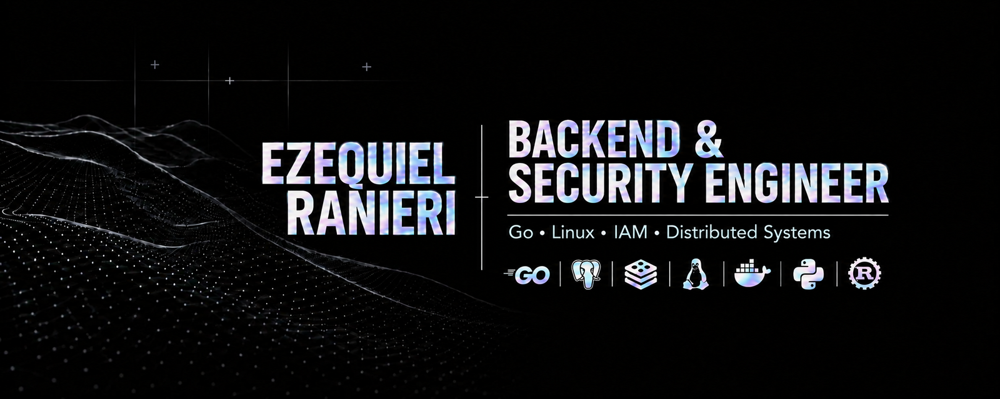
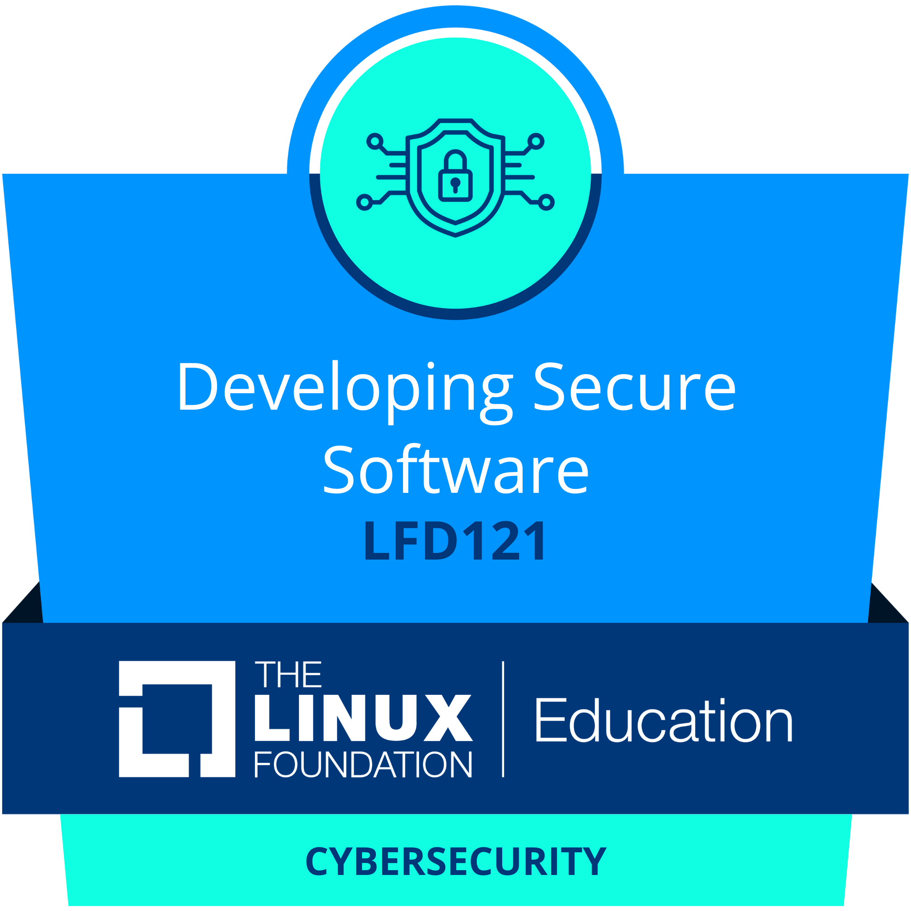

```text
#########%%%%%%%%%%%%%%%%%%%%%%%%%%%%%%%%%%%%####*********   ez@ez
#########%%%%%%%%%%%%%%%%%@@@@@@@@@%%%%%%%%%%%#######*****   -------------------------------
######%%%%%%%%%%%%%@@%%@@@%%#+==+*%@@@@%%%%%%%%#########**   OS................ Debian + Windows
**###%%%%%%%%%%%%%@%%@@#+-.:       :+*%@@%@@%%%%##########   Uptime............ Self-taught
**####%%%%%@@@@@@@%@@*-.              .=@%%@@@%%%#########   Host.............. Salto Grande, Santa Fe
#####%%%%%%@@@@@@%@%-                   =%%%@@@%%%%%######   Kernel............ Hexagonal / Clean Arch
#####%%%%%@@@@@@%%%:                     =%%@@@%%%%%######   Shell............. ghostty · bash · herdr
####%%%%%@@@@@@@%@#         .             *@%@@@%%%%%######   Primary Stack..... Go (primary) · PostgreSQL · Linux
###%%%%%@@@@@@@@%@#     :++.:=.       .   *@%@@@%%%%%######   IDE............... Pi + Visual Studio Code
###%%%%@@@@@@@@@@@%-.:-=====+*#**#+:-+*=- *@%@@@%%%%%%#####   Languages......... Go, Python, SQL
###%%%%@@@@@@@@@@%%*::#-  ..-*%%##+=#=:+= %@%@@@%%%%%%%####   Infra............. PostgreSQL, Redis, RabbitMQ
###%%%%@@@@@@@@@@@%@*+%**#+*%%##*+=+*+*+.-@%@@@%%%%%%%#####   Focus............. Backend & Security Engineering · IAM · RLS
###%%%%@@@@@@@@@@@%@*+%**#+*%%##*+=+*+*+.-@%@@@%%%%%%%#####   Specialties....... RLS · Token rotation · Distributed systems
##%%%%%%%@@@@@@@@@@%@@%%#*%#**++++=+=+= .%%%@@%%%%%%%%#####   Status............ Open to backend/security
#%%%%%%%%@@@@@@@@@@%%+::=*#****+++==+*- -@%@@@%%%%%%%%#####   Learning.......... Systems security · Trusted AI infrastructure
%%%%%%%%%@@@@@@@@@@@%@#-:---+*++++=--+**=%@%%%%%%%%%%%#####   Building.......... go-authz · go-durable-jobs · aegis
%%%%%%%@@@@@@@@%%%%%%%*-::--==-::::+++*%*#@@@@@%%%%%%%#####   Contact........... ezequielranieri.contact@gmail.com
%%%%%%%@@@@@%%%%@@@@@%%#=:--:.   .:=+***#* :+#%%@@@%%%%#####   Portfolio......... ezequielranieri.vercel.app
#%%%%%%%%%%@@@@@%#*=---   ::.  .:=*####*-   :-=+*##%%%%###   Last public push.. 2 days ago (ezequielranieri/new-portfolio)
#%%%%%%%%@@%*+-:.    . .          ..:::..          ..:-=*#%#    
##%#%%%%%*-:        . .                                .=#    
#####%%#:             .                                  .    
####%#+.          .  ..                                   
####*-      .    .   .. ..   .                            
###=.     ..     .:--::===::-=.:::::. .. .:               
%*:              +=+*+:++=+:=++:--+++ .--=+:-:            
+                .::.....  .. ... ..:  .----:              
```

<br>

<div align="center">


</div>

<br>

<div align="center">



<br>

[](mailto:ezequielranieri.contact@gmail.com)
[](https://ezequielranieri.vercel.app/)
[](https://www.linkedin.com/in/ezequielranieri)

</div>

---

**Backend & Security Engineering** · Go · PostgreSQL · RLS · IAM · Distributed Systems

Self-taught backend engineer based in Salto Grande, Santa Fe, Argentina. I focus on Go, PostgreSQL, and security-oriented backend systems: identity and access management, tenant isolation with Row Level Security, durable job processing, and distributed systems. My selected projects include documented design decisions, integration tests against real infrastructure, and honest retrospectives. Long-term direction: systems security and trusted AI infrastructure.

<br>

## Selected Work

### Go Authz

- **Problem:** Other internal services need a shared answer to authentication, session safety, and "can this user do X?" without reimplementing roles and permissions per service. A stolen refresh token or a forgotten `WHERE tenant_id = ?` becomes a breach, not a bug.
- **Engineering:** Go service for authentication, refresh-token rotation with family-based reuse detection, role-based authorization, and tenant isolation with database-level enforcement (PostgreSQL RLS + trigger), complemented by application middleware. Argon2id passwords, JWT (ES256) with multi-key rotation, Redis rate limiting (Lua, atomic). A single `/authorize` endpoint other services call with the caller's own access token.
- **Verifiable evidence:** CI workflow (golangci-lint, vet, build, test, gitleaks secret scanning); unit tests across domain, use cases, adapters, HTTP handlers, and middleware; integration tests against real PostgreSQL and Redis via testcontainers; `DECISIONS.md` documenting decisions and limitations. The repository also documents query-count and concurrency assertions; I have not executed them locally.
- **Value to an organization:** a reusable IAM component with tenant isolation enforced at the database, documented security decisions, and a test suite that runs against real infrastructure instead of mocks.
- **Limitations:** metrics and tracing are not implemented (structured logging and health/ready checks only); service accounts (M2M) are not implemented; Redis is a central dependency for rate limiting and session security.

### Go Durable Jobs

- **Problem:** Asynchronous work that disappears on crash, duplicates on retry, or is lost to a transient failure. Without a durable queue and idempotency, background jobs are unreliable.
- **Engineering:** Go durable job processor using PostgreSQL as the source of truth. Idempotency through a unique constraint; dequeue via `SELECT ... FOR UPDATE SKIP LOCKED`; exponential backoff with jitter and a configurable attempt limit; explicit dead-letter queue with a requeue endpoint; graceful shutdown with a drain window; Prometheus metrics.
- **Verifiable evidence:** unit tests (domain, application, handler, worker, telemetry) and integration tests against PostgreSQL (isolated database, build tag `integration`); benchmarks including `SKIP LOCKED` scaling under concurrency; `DECISIONS.md` and an honest retrospective documenting what was deliberately left out.
- **Value to an organization:** a reference implementation of a durable job processor with documented trade-offs and environment-specific performance measurements.
- **Limitations:** no authentication or authorization on the HTTP API; the worker pool uses a single hardcoded handler (no registry); no circuit breaker; the repository has no CI workflow; benchmarks are environment-specific.

### Aegis

- **Problem:** Running untrusted WebAssembly under resource limits, with capability-based host functions and signed execution receipts.
- **Engineering:** Rust WebAssembly sandbox runtime. Capability-based host functions (not WASI) with four capability names; Wasmtime sandbox with memory, table, instance, and memory limits; epoch interruption and fuel metering for CPU accounting; Ed25519 + BLAKE3 signed, hash-chained execution receipts; two-phase prepare/commit/abort; gRPC server with optional mutual TLS.
- **Verifiable evidence:** CI workflow running `cargo fmt --check`, `cargo clippy --all-targets -- -D warnings`, and `cargo test`; integration tests (sandbox, fuel, network HTTP, two-phase, gRPC boundary, config); `DECISIONS.md` with 16 architecture decision records; openspec specifications. I have not executed the Rust toolchain locally.
- **Value to an organization:** a WebAssembly runtime with capability-based host functions and signed execution receipts, usable as a sandbox component for untrusted code.
- **Limitations:** mutual TLS is optional; the unencrypted mode prints a warning and is not suitable for production use; requires the Rust toolchain to build.

<br>

## Other relevant projects

- **[Agent Gateway](https://github.com/ezequielranieri/agent-gateway)** (Go) — multi-tenant LLM gateway with tenant isolation (RLS FORCE), append-only audit hash chain, human-in-the-loop approvals, guardrails, model routing with fallback, WASM tool sandbox, and agent delegation. MVP (Phases 0–9); some adapters are stubbed (Anthropic/Ollama) and the AD-013 JWT transport is not wired. CI + CD staging + release.
- **[Agro IAM](https://github.com/ezequielranieri/agro-iam)** (Go) — multi-tenant IAM with RLS, Argon2id, JWT, refresh-token rotation, and Redis rate limiting. Live demo available. Learning/portfolio project.
- **[Mettle](https://github.com/ezequielranieri/mettle)** (Go) — agent evaluation and safety framework with declarative YAML specs, authorization oracles, visibility checks, LLM-as-judge, regression store, and CI gate. v0.1.0, expanding the scenario corpus.

<div align="center">

[**Explore all repositories →**](https://github.com/ezequielranieri?tab=repositories)

</div>

<br>

## Tech Stack

<div align="center">


</div>

<br>

Also used: Rust (Aegis), Python (earlier IAM experiment).

<br>

## Certifications

| | |
|---|---|
| [](https://www.credly.com/badges/5a40b7c0-c673-4cb9-8845-1b2b9212eac3/public_url) | **Secure AI/ML Driven Software Development**<br>LFEL1012 — [Verify](https://www.credly.com/badges/5a40b7c0-c673-4cb9-8845-1b2b9212eac3/public_url) |
| [](https://www.credly.com/badges/6cfd4b7b-97a2-41ba-a9aa-dae369f89453/public_url) | **Developing Secure Software**<br>LFD121 — [Verify](https://www.credly.com/badges/6cfd4b7b-97a2-41ba-a9aa-dae369f89453/public_url) |

<br>

## Engineering Principles

| | |
|---|---|
| **01** | Tenant isolation is enforced at the database (PostgreSQL RLS + trigger), complemented by application middleware — demonstrated in go-authz. |
| **02** | Security-sensitive flows are documented with decision records and honest retrospectives (DECISIONS.md across repositories). |
| **03** | Correctness claims are verified with tests against real infrastructure (testcontainers), not asserted from mocks. |
| **04** | Idempotency, retries, and graceful shutdown are designed into async paths from the start (go-durable-jobs). |

<br>

<div align="center">

**Let's build together.** &nbsp;→&nbsp; [ezequielranieri.contact@gmail.com](mailto:ezequielranieri.contact@gmail.com)

Salto Grande, Santa Fe, Argentina

</div>
